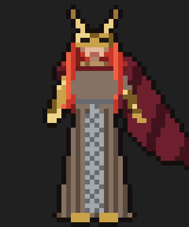
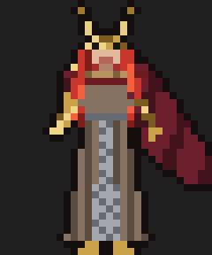
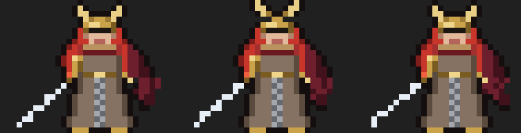

# blade-of-commits

A commit button for [Claude Code](https://claude.com/claude-code). When Claude finishes a task that changed files, a band appears above the prompt: one click suggests a clean commit message for exactly those changes, a second click has Claude commit them. A pixel-art Malenia, Blade of Miquella, keeps you company while it happens.

<p>
  
  &nbsp;
  
</p>



## What it does

1. **Tracks the task's files.** Every file Claude writes with `Edit`, `Write` or `NotebookEdit` is remembered. When the turn ends, the files that git still reports as changed show up in the band: `2 files changed · [ Suggest commit ] [ Hide ]`.
2. **Suggests a message.** *Suggest commit* sends the diff of those files, plus what you asked Claude for, to Haiku and shows a [Conventional Commits](https://www.conventionalcommits.org/) message: a subject line of at most 72 characters and a few bullet points when the change is not trivial.
3. **Claude commits it.** *Commit* asks Claude to stage only those files and commit with exactly that message. Because Claude runs git itself, your pre-commit hooks run as usual; if one fails, Claude reports what happened instead of fixing things on its own.
4. **Malenia reacts.** She rests while the band waits, performs the Waterfowl Dance while the message is written and while Claude commits, raises her blade over the preview, blooms into Scarlet Aeonia when the commit lands, and turns grey when something goes wrong.

| Button | Hotkey | |
| --- | --- | --- |
| Suggest commit | `c` | write a commit message for the tracked files |
| Hide | | forget the tracked files and hide the band |
| Commit | `c` | let Claude commit with the suggested message |
| Regenerate | `r` | write another message |
| Cancel | | back to the file list |

Hotkeys work while the band has the focus: click into it (in the terminal also `Ctrl+X`, then `Tab`). Typed into the prompt, a `c` is just a `c`. There is also a slash command: `/commit-suggest`.

## Requirements

- Claude Code **2.1.288 or newer**. The mod is written against Claude Code's function-hook plugin API, which is in early access and may change between releases.
- A git repository as the session's working directory.
- The message is written by `haiku` through your own Claude Code session, so each suggestion costs a small amount of usage.

## Install

Clone the repository somewhere permanent:

```bash
git clone https://github.com/<you>/blade-of-commits.git ~/blade-of-commits
```

**Terminal, one session:**

```bash
claude --plugin-dir ~/blade-of-commits
```

**Every session, desktop app included:** add the folder to `CLAUDE_CODE_PLUGIN_DIRS` in the `env` block of `~/.claude/settings.json`, then start a new session:

```json
{
  "env": {
    "CLAUDE_CODE_PLUGIN_DIRS": "~/blade-of-commits"
  }
}
```

Several folders are separated by `:` on macOS and Linux, `;` on Windows.

## How it looks where

- **Desktop app:** Malenia is a crisp SVG (40 × 48 pixels at 4 CSS pixels each), animated with CSS.
- **Terminal:** she is drawn with half-block characters, two pixels per cell. When the band has at least 18 rows and 80 columns she is drawn at 30 × 36 pixels, otherwise a hand-drawn 20 × 24 variant takes over, so a large window shows her best.

## Limitations

- Only files changed through `Edit`, `Write` and `NotebookEdit` are tracked. A file Claude changes through a shell command (`sed`, a code generator, `npm install`) is not part of the suggestion.
- Files you change yourself are never staged; a file you had already modified before the task is committed whole if Claude also edited it.
- Commit messages are written in English.

## Development

```
.claude-plugin/plugin.json   manifest
hooks/hooks.json             points at the hooks module
hooks/register.tsx           tracking, message generation, the band, the commit
hooks/stage-svg.ts           Malenia for the desktop app (SVG + CSS animation)
hooks/malenia.tsx            Malenia for the terminal (half blocks, frame timer)
hooks/sprite.ts              the pixel data, generated
hooks/register.test.tsx      tests
types/index.d.ts             the mod's state contract
tools/sprites/build.py       Malenia as shapes; regenerates hooks/sprite.ts and docs/*.png
```

Load your working copy with `claude --plugin-dir .`; an interactive session reloads the mod whenever you save a file. Then:

```bash
claude plugin validate .
claude plugin test .
npx -p typescript tsc -p .
```

`tsc` needs the type declarations Claude Code writes into `.claude-plugin/types/` the first time it loads the mod.

To change Malenia, edit the shapes (or the hand-drawn small variant) in `tools/sprites/build.py` and run it; it needs nothing but Python 3:

```bash
python3 tools/sprites/build.py
```

## Disclaimer

An unofficial fan project. Malenia and Elden Ring belong to FromSoftware and Bandai Namco; this project is not affiliated with or endorsed by them. The pixel art is original and contains no game assets.
